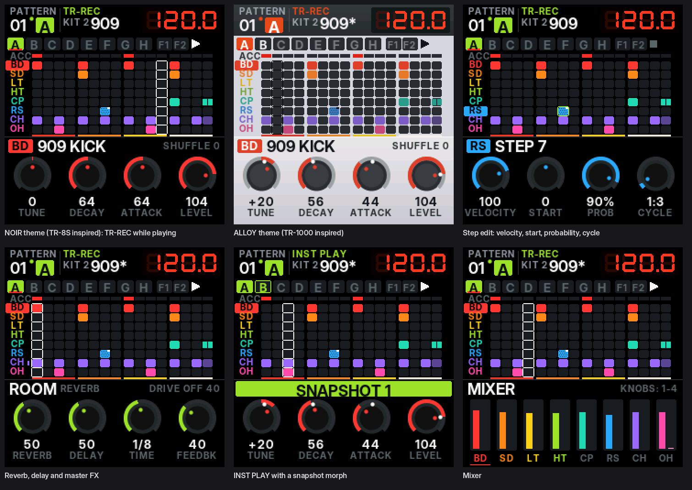

# PULSAR-8 — a TR-style rhythm machine firmware for the M-VAVE FM-1

PULSAR-8 is replacement firmware that turns the M-VAVE FM-1 into a standalone **8-track drum machine**
with the workflow of a Roland TR-8S / TR-1000: step programming on 16 pads (TR-REC), variations A–H with
chaining, two fill-ins and auto fill, sub-steps, flams, weak beats, accents, probability, note cycles,
off-grid timing, per-track length / direction / rotate / shuffle, motion recording, parameter locks,
step loop, rolls, snapshots with morph, mute / solo, reverb / delay / master FX, and MIDI clock in / out.

It plays its own **analog-style drum models** (808 / 909 / 606 / CR-78 / 7X7 styles, built from the
circuits' published behaviour, not samples of them) and **vintage sample-machine kits** (LinnDrum-,
DMX-, Drumulator- and SP-12-style playback of CC0 acoustic recordings: 8-bit µ-law, fixed sample clock,
no interpolation, the machine's bit depth and output filter).

<p align="center"></p>

Two themes share every screen: **NOIR**, after the TR-8S (black, lime-green glow, colour-coded tracks,
the red seven-segment tempo) and **ALLOY**, after the TR-1000 (silver-grey, graphite displays,
restrained orange). The TR-808's red / orange / yellow / white step-group stripe runs under the grid.

> **Status: 1.0 beta, not yet tested on a physical FM-1.** The firmware builds with the JieLi toolchain,
> passes every build-time hardware check and the full host test suite (audio, sequencer, UI, storage with
> power cuts, the update loader and rescue mode), but nobody has run this build on a device yet. Install it
> only if you are ready to use the USB rescue (below). Reports are welcome.

**Not affiliated with Roland or M-VAVE.** "TR-8S", "TR-1000", "TR-808", "TR-909", "TR-606", "CR-78",
"LinnDrum", "DMX", "Drumulator" and "SP-12" are trademarks of their owners and are used here only to
describe the styles of sound and workflow that inspired this independent project. No Roland or other
proprietary code, artwork or samples are included.

## Contents

- [What you get](#what-you-get)
- [Install](#install) · [Going back / rescue](#going-back-and-rescue)
- [Controls at a glance](#controls-at-a-glance) — the complete guide is [docs/MANUAL.md](docs/MANUAL.md)
- [Building and testing](#building-and-testing) — [docs/BUILDING.md](docs/BUILDING.md)
- [Design and research notes](docs/RESEARCH.md)
- [Credits and licences](#credits-and-licences)

## What you get

| | |
| --- | --- |
| Tracks | 8 (any instrument on any track), each monophonic like a TR circuit; closed hat chokes open hat |
| Instruments | 110: 55 synthesised models, 55 vintage-sample voicings, all level-matched; TUNE, DECAY, CTRL (ATTACK / SNAPPY / TONE / PITCH / COLOR / DRIVE), LEVEL, PAN, reverb and delay sends; ALT INST voicings |
| Kits | 16: 808, 909, 606, 7X7, CR78, LM, DMX, DRMU, SP12, ACOUSTIC, HOUSE, TECHNO, ELECTRO, HIPHOP, TRAP, LO-FI (all editable, written to flash) |
| Patterns | 16, each with variations A–H + FILL IN 1 / 2 of up to 16 steps, an accent lane, 384 motion points and 8 snapshots |
| Steps | on / weak / flam / alt; sub-steps 1/2 1/3 1/4 and TR-1000 sub-step patterns; velocity; probability (+ master probability); cycle conditions A:B, 1ST, !1ST, FILL, !FILL; start timing ±50 % |
| Tracks (TR-1000) | own LAST (polymeter), DIRECTION (FWD, BWD, P-P, R-L, L-R, RND, DNK), ROTATE ±8, START ±50 %, SHUFFLE |
| Playback | variation chains in any order, queued pattern change, pattern chains, manual fill, auto fill every 2–32 bars, scatter, step loop with 1/2 and 1/4 rolls, rolls 1/16–1/64, flam spacing, scale 1/16 · 1/32 · 1/16T · 1/8T, shuffle |
| Performance | INST PLAY / INST REC (quantised or free), mute / solo, MOTION (record knob moves into the steps), parameter locks, 8 snapshots per pattern with a MORPH knob, tap tempo |
| Effects | reverb (ROOM / HALL / PLATE), tempo-synced delay, master FX (FILTER, DRIVE, CRUSH, COMP, LO-FI, ISOLATOR), bus limiter |
| MIDI / USB | class-compliant USB MIDI in / out (notes, clock, start / stop), TRS MIDI in, clock sync from USB or TRS, USB audio input (the FM-1 appears as a recordable 44.1 / 48 kHz stereo source) |
| Storage | WRITE to flash (power-fail safe journal), optional auto-save when stopped, settings and theme remembered |

## Install

PULSAR-8 is installed over USB with the same update mechanism as SLOOP (its installer and update loader
are reused unchanged), so it can be installed over the official firmware, over SLOOP, or over itself.

The package: [`docs/firmware/pulsar-1.0-beta.fwsc`](docs/firmware/pulsar-1.0-beta.fwsc)
(SHA-256 `f1d317662cd0d035bf5a93a6699eb689ad775b9e5586fd10fd78e376b238294d`), or build your own.

**From the browser (Chrome or Edge):** the installer page is [`docs/installer/`](docs/installer/index.html).
Web MIDI needs a secure page, so either enable GitHub Pages for this repository (branch, folder `/docs`) and open
`https://<user>.github.io/<repo>/installer/`, or serve it locally:

```sh
python3 -m http.server --directory docs 8000     # then open http://localhost:8000/installer/
```

Connect the FM-1 with a data cable (no hub), press **Install**, allow MIDI access. The page checks the
package (identity and SHA-256) before anything is written; it also accepts your own build or the official
FM-1 V15 file to go back.

**From the command line** (`pip3 install mido python-rtmidi`):

```sh
python3 tools/fm1_install.py docs/firmware/pulsar-1.0-beta.fwsc
python3 tools/fm1_install.py --info        # what the connected FM-1 runs
```

Installing PULSAR-8 replaces SLOOP's saved projects in flash (both use the same data area). Keep a
backup from SLOOP's editor first if you want to return to them.

## Going back and rescue

- Any other `.fwsc` (the official M-VAVE V15 file, SLOOP) installs the same way.
- If the FM-1 does not start PULSAR-8: hold **OCT−** alone while switching on. The screen shows
  *PULSAR-8 USB RESCUE*; install a package again from the installer. Two failed boots in a row also
  enter this mode automatically.
- If even that fails, the FM-1 can be recovered through the chip's USB boot mode with
  [FM-1-transporter](https://github.com/kurogedelic/FM-1-transporter).

## Controls at a glance

The FM-1's 16 white keys are the 16 TR step pads; the black keys select instruments.

| FM-1 | PULSAR-8 |
| --- | --- |
| white keys 1–16 | steps (TR-REC) · patterns (PTN SELECT) · pads, rolls, snapshots (INST PLAY) · step loop |
| black keys F#3–A#4 | instrument select BD SD LT HT CP RS CH OH (tracks 1–8) |
| black C#5 · D#5 · F#5 | **LAST** · **CLEAR** · **FILL** (manual trig) |
| PLAY · REC · SEQ · ARP | START/STOP · TR-REC · PTN SELECT · INST PLAY (again: INST REC) |
| OCT− · OCT+ | **SHIFT** · **VARIATION** (+ keys 1–8 = A–H, several = chain; 9 / 10 = FILL IN 1 / 2) |
| SEL · ENV · LFO | ACCENT · SUB (SHIFT: FLAM) · MOTION |
| EDIT · FX · GLO | INST (SHIFT: TRACK SETTING) · EFFECTS (SHIFT: MFX ON) · MIXER / hold: MUTE |
| SAVE · HOME | WRITE (SHIFT: COPY) · main page (hold: UTILITY, SHIFT: TAP tempo) |
| SELECT · ALGORITHM · PRESETS | VALUE / TEMPO · SHUFFLE (INST PLAY: MORPH) · KIT |
| KNOB 1–4 | TUNE · DECAY · CTRL · LEVEL of the selected instrument; a step held: VELOCITY · START · PROB · CYCLE |

A first beat: press a black key (BD), tap white keys 1, 5, 9, 13; select SD, tap 5 and 13; press PLAY.
Hold a step and turn the knobs to edit it. Hold OCT+ and tap 1 and 2 to chain variations A and B.
Everything else is in [docs/MANUAL.md](docs/MANUAL.md).

## Building and testing

```sh
tools/get_toolchain.sh                         # JieLi pi32v2 clang toolchain (Linux x86-64)
git clone --depth 1 --branch AC79NN_SDK_V1.2.1_2023-12-13 \
    https://gitee.com/Jieli-Tech/fw-AC79_AIoT_SDK.git ~/fw-AC79_AIoT_SDK   # 3 files go in the package
./build.sh                                     # build/pulsar.bin, build/pulsar.fwsc
tests/run_tests.sh                             # the host test suite (no hardware)
```

The host simulator runs the whole firmware on a PC from a script of key presses and writes the screens
and the audio: `build/tests/sim tests/ui_tour.txt out/`. See [docs/BUILDING.md](docs/BUILDING.md).

## Credits and licences

- PULSAR-8's application (`firmware/src/pz_*`, `pulsar.c`, `host/`, `tools/gen_*`) is new code, GPL-3.0-only.
- The hardware layer — HAL, update loader, USB MIDI / audio, M-UPGRADE update entry, USB rescue, flash
  driver, build packaging — comes from **[SLOOP](https://github.com/isod89/sloop-fm1)** and
  **[Felucca](https://github.com/hugelton/Felucca)** by **Leo Kuroshita / Hügelton Instruments** and the SLOOP
  contributors (GPL-3.0-only), whose reverse engineering made custom FM-1 firmware possible. Thank you.
- Hardware research: **[FM-1-RE](https://github.com/AL-255/FM-1-RE)** (AL-255).
- Drum recordings: Versilian Studios VCSL (CC0 1.0), see `assets/samples-cc0/ATTRIBUTION.txt`.
- Font: Inter Display (SIL OFL 1.1), `assets/fonts/Inter-LICENSE.txt`.
- JieLi AC79 SDK files placed in the package at build time (Apache-2.0); none are in this tree.

Details: [LICENSING.md](LICENSING.md). No warranty: installing third-party firmware is at your own risk.
