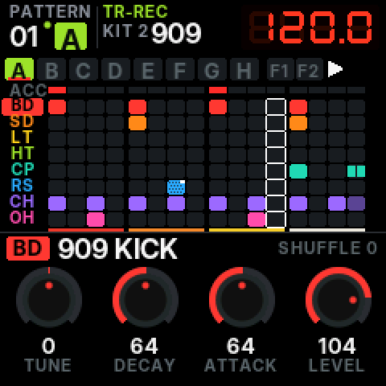
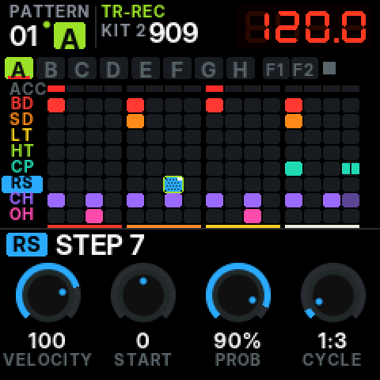
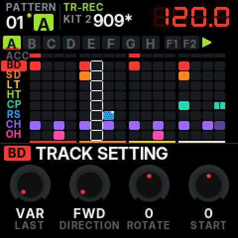
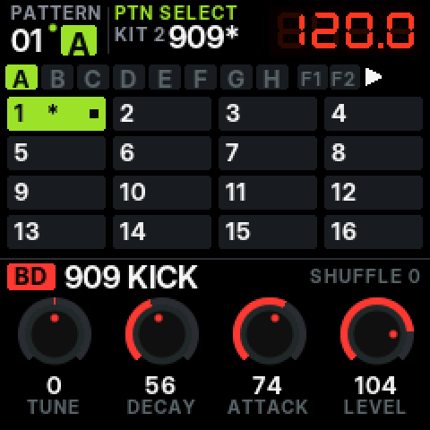
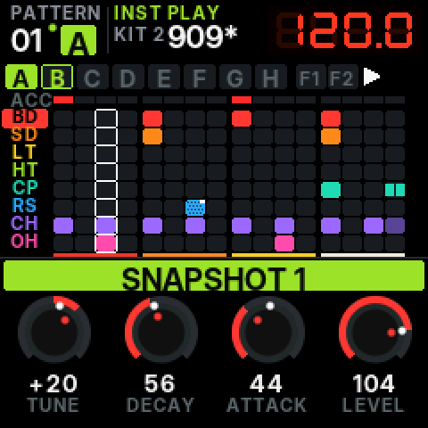
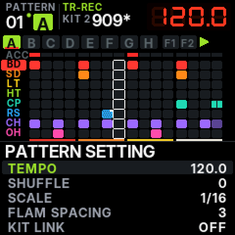

# PULSAR-8 manual

PULSAR-8 runs the FM-1 as an eight-track TR-style drum machine. This manual follows the order of the
TR-8S Reference Manual where the two instruments share a function, and notes where PULSAR-8 adapts it to
the FM-1's panel or adds a TR-1000 feature.

- [1. The panel](#1-the-panel)
- [2. The screen](#2-the-screen)
- [3. Patterns, variations, kits](#3-patterns-variations-kits)
- [4. TR-REC: step recording](#4-tr-rec-step-recording)
- [5. Editing a step](#5-editing-a-step)
- [6. Variations, chains, fills](#6-variations-chains-fills)
- [7. Lengths and track settings](#7-lengths-and-track-settings)
- [8. Playing: tempo, shuffle, PTN SELECT](#8-playing-tempo-shuffle-ptn-select)
- [9. INST PLAY and INST REC](#9-inst-play-and-inst-rec)
- [10. Step loop](#10-step-loop)
- [11. Motion and parameter locks](#11-motion-and-parameter-locks)
- [12. Snapshots and morph](#12-snapshots-and-morph)
- [13. Mute, solo, mixer](#13-mute-solo-mixer)
- [14. Sounds: instruments and kits](#14-sounds-instruments-and-kits)
- [15. Effects](#15-effects)
- [16. Write, copy, clear](#16-write-copy-clear)
- [17. Pattern setting](#17-pattern-setting)
- [18. Utility](#18-utility)
- [19. MIDI and USB](#19-midi-and-usb)
- [20. Cheat sheet](#20-cheat-sheet)

## 1. The panel

The FM-1's printed labels belong to its original synthesizer; PULSAR-8 gives them TR roles.

| FM-1 control | PULSAR-8 role | TR-8S / TR-1000 equivalent |
| --- | --- | --- |
| 16 white keys | step pads 1–16 | pads [1]–[16] |
| black keys F#3 G#3 A#3 C#4 D#4 F#4 G#4 A#4 | instruments 1–8 (BD SD LT HT CP RS CH OH in most kits) | instrument select [BD]…[RC] |
| black key C#5 | **LAST** | [LAST] |
| black key D#5 | **CLEAR** | [CLEAR] |
| black key F#5 | **FILL** (manual trig) | AUTO FILL IN [MANUAL TRIG] |
| PLAY | START / STOP | [START/STOP] |
| REC | TR-REC | [TR-REC] |
| SEQ | PTN SELECT | [PTN SELECT] |
| ARP | INST PLAY (again: INST REC) | [INST PLAY], [INST REC] |
| OCT− | **SHIFT** | [SHIFT] |
| OCT+ | **VARIATION** | [A]–[H] |
| SEL | ACCENT | ACCENT [STEP] |
| ENV | SUB (with SHIFT: FLAM) | [SUB] |
| LFO | MOTION | MOTION [ON] / [REC] |
| EDIT | INST page (with SHIFT: TRACK SETTING) | [INST] |
| FX | EFFECTS page (with SHIFT: MASTER FX on / off) | REVERB, DELAY, MASTER FX sections |
| GLO | MIXER (hold: MUTE) | [MUTE], mixer screens |
| SAVE | WRITE (with SHIFT: COPY) | [WRITE], [COPY] |
| HOME | main page (hold: UTILITY; with SHIFT: TAP) | [UTILITY], tap tempo |
| SELECT (large knob) | VALUE: tempo on the main page, cursor in lists | [VALUE], [TEMPO] |
| ALGORITHM | SHUFFLE (INST PLAY: MORPH) | [SHUFFLE], MORPH slider |
| PRESETS | KIT | [KIT] + [VALUE] |
| KNOB 1–4 | TUNE, DECAY, CTRL, LEVEL of the selected instrument | [TUNE] [DECAY] [CTRL] and the level fader |
| VOLUME | master volume | [VOLUME] |

The keys light like a TR's pads: in TR-REC the steps of the selected instrument are lit and the
running light moves across them (a lit step goes dark as it plays). The black keys show the selected
instrument and flash on each hit; PLAY blinks on the beat; REC, SEQ and ARP show the mode.

## 2. The screen



- **Header:** pattern number and the variation playing (the box turns red during a fill-in; a dot means
  the pattern is edited and not written), the mode, the kit, and the tempo on the red seven-segment display.
- **Variation bar:** A–H, FILL IN 1 / 2. Filled = playing, outlined = in the chain, red underline =
  the TR-REC target, bright letter = has steps. Right: play / stop, **M** for motion (blinking red while
  recording it), **S** when synced to MIDI clock.
- **Grid:** the accent lane, then the eight tracks of the variation being edited, each in its colour.
  A white frame is each track's playing step. Dim cells are past the track's or the variation's last
  step. Cell marks: sliced = sub steps, dark left edge = flam, dotted = probability, white corner = a
  cycle condition, white side line = start timing, white bottom line = ALT INST, coloured bottom dot =
  motion on that step. Below the grid, the TR-808's red / orange / yellow / white step-group stripe.
- **Bottom:** the selected instrument and its four knobs, or the page in use (effects, instrument,
  mixer, track or pattern setting, utility). Messages appear in a bar over the title for a moment.

The themes (UTILITY > THEME): **NOIR** after the TR-8S and **ALLOY** after the TR-1000. They change
colours only; the theme is remembered.

<br clear="right">

## 3. Patterns, variations, kits

A **pattern** holds variations A–H and two fill-ins (FILL IN 1, 2), each up to 16 steps, for the eight
tracks plus an accent lane, its motion data and snapshots, and settings (tempo, shuffle, scale, flam
spacing, fill settings). There are 16 patterns.

A **kit** holds the eight instruments (any instrument on any track) with their TUNE, DECAY, CTRL,
LEVEL, PAN, reverb and delay sends and colour, plus the reverb, delay and master effect settings.
There are 16 kits. A pattern can call its own kit (PATTERN SETTING > KIT LINK).

As on a TR, edits stay in memory until you **WRITE** (section 16). With AUTO SAVE on (the default),
edited patterns and kits are written when the transport is stopped and nothing has been touched for
4 seconds.

## 4. TR-REC: step recording

Press **REC** (it lights). Press a black key to select an instrument, then the white keys to place
its steps. This works stopped or playing.

- A key on an empty step turns it on at once. Tapping a lit step turns it off (holding it and turning a
  knob edits it instead, section 5).
- **Weak beats:** hold SHIFT (OCT−) and press a step: a ghost note (velocity 48).
- **Accents:** hold SEL and press steps, or tap SEL to latch ACCENT input. The accent lane is shared by
  all instruments; its level is in PATTERN SETTING, or hold SEL and turn SELECT.
- **Sub steps:** hold ENV and press a step: none → 1/2 → 1/3 → 1/4. Or tap ENV to latch SUB input, turn
  SELECT for the division, then press steps.
- **Flams:** SHIFT + ENV latches FLAM input; steps toggle their flam. The flam spacing is in PATTERN
  SETTING (0–8).
- **ALT INST:** hold the instrument's black key and press a step: that step plays the instrument's
  alternate voicing (for example 808 KICK → BOOM KICK, 909 CRASH ↔ 909 RIDE, 808 RIM → CLAVES; the
  others play five semitones up).
- **Clear a step:** hold CLEAR (D#5) and press it. **Clear the track:** hold CLEAR and press the black key.
  **While playing,** hold CLEAR alone: the selected track's steps are erased as the playhead passes.

The variation you record is the TR-REC target (red underline). Selecting a variation (section 6) makes
it the target; to record into one without changing what plays, hold REC while choosing it.

## 5. Editing a step



Hold a step key (TR-1000 style) and turn:

| Knob | Step parameter |
| --- | --- |
| KNOB 1 | **VELOCITY** 1–127 (default 100, weak 48) |
| KNOB 2 | **START**: −50 … +50 % of a step, off the grid (TR-1000) |
| KNOB 3 | **PROB**: 1–100 % chance to play (the pattern's MASTER PROB adds to it) |
| KNOB 4 | **CYCLE**: 1:1, A:B (plays on the A-th of every B passes, B = 2–8), 1ST, !1ST, FILL, !FILL |
| SELECT | sub step pattern: 1/2, 1/3, 1/4 and TR-1000-style triplet / quadruplet patterns |
| ALGORITHM | flam on / off |
| SHIFT + KNOB 1–4 | a **parameter lock**: TUNE, DECAY, CTRL or LEVEL for this step only (section 11) |

Holding several steps edits them together. A step you edited is not turned off when you let go.

<br clear="right">

## 6. Variations, chains, fills

Hold **OCT+ (VARIATION)** and press:

- keys **1–8**: variations **A–H**. Pressing several while holding makes a **chain** in the order
  pressed (A A B C …, up to 16, TR-1000 VARIATION CHAIN; TR-8S's lit variations are the case A B C …).
  Playing, the change starts at the next cycle; stopped, at once.
- keys **9 / 10**: edit **FILL IN 1 / 2** (they become the TR-REC target).
- key **16**: AUTO FILL IN on / off.
- with **CLEAR** held: clear that variation. With COPY armed (SHIFT + SAVE): paste the TR-REC
  target into it.

**Fill-ins:** **FILL (F#5)** plays the fill-in from the current step to the end of the cycle (MANUAL
TRIG), then the chain carries on. **AUTO FILL IN** plays it on the last bar of every 2, 4, 8, 12, 16 or
32 bars: SHIFT + FILL turns it on / off, FILL held + SELECT sets the interval (also in PATTERN SETTING).
FILL TYPE selects FILL IN 1, FILL IN 2 or **SCATTER** (the steps of the variation exchanged and
reversed in a new way every cycle, TR-8S). Steps with the condition FILL play only during a fill,
!FILL never.

## 7. Lengths and track settings

**LAST (C#5)** held + a step key: the variation ends on that step (1–16). Hold LAST and an instrument
key, then a step: that track's own length (TR-8S track LAST, shared by all variations) — a polymeter
against the others. LAST + SHIFT + instrument key returns the track to the variation's length.

**TRACK SETTING** (SHIFT + EDIT), for the selected track (SELECT changes the track):

| Knob | Setting |
| --- | --- |
| KNOB 1 | LAST: VAR (the variation's) or 1–16 |
| KNOB 2 | DIRECTION: FWD, BWD, P-P (ping-pong), R-L (2 1 4 3 …), L-R (15 16 13 14 …), RND, DNK (a drunk walk) |
| KNOB 3 | ROTATE −8 … +8: the pattern shifted around its loop |
| KNOB 4 | START −50 … +50 %: the whole track early or late |
| ALGORITHM | SHUFFLE −100 … +100, added to the pattern's shuffle |



## 8. Playing: tempo, shuffle, PTN SELECT

- **PLAY** starts and stops. **SHIFT + PLAY** while playing returns to the top; stopped, it silences
  ringing sounds.
- **Tempo:** SELECT on the main page (40.0–300.0; SHIFT for 0.1 steps). **Tap tempo:** SHIFT + HOME,
  three taps or more. TEMPO SRC (UTILITY) chooses one system tempo or each pattern's own.
- **Shuffle:** ALGORITHM on the main page, −100 (pushed) … +100 (the off-beat 1/16 half a step late).
- **Kit:** PRESETS on the main page.

**PTN SELECT:** tap **SEQ**. The grid shows the 16 patterns (lit = playing, blinking = next, a dot
= has steps, * = edited). Press a key: stopped, it changes at once; playing, at the end of the current
chain, as on a TR. Press two keys at once for a **pattern chain** between them. Hold **SEQ** and press a
key in any other mode to change pattern without leaving that mode.



## 9. INST PLAY and INST REC

Press **ARP**: the white keys become pads.

| Keys | Function |
| --- | --- |
| 1–8 | play instruments 1–8 (also the black keys) |
| 9 / 10 / 11 (hold) + pads | **ROLL** 1/16, 1/32, 1/64 on the beat grid, as long as both are held |
| 12 (hold) + pads | flam |
| 13 (hold) + pads | weak (ghost) |
| 14 (hold) + pads | accented |
| 15 (hold) + 1–8 | recall **snapshot** 1–8 (section 12) |
| 16 (hold) + 1–8 | store snapshot 1–8 |

Press **ARP** again for **INST REC** (the mode reads INST REC in red): while playing, what you play is
recorded into the TR-REC target variation, quantised to the nearest step (or kept off-grid with REC
QUANTIZE off in UTILITY). The hit you play sounds at once and the step does not sound twice. ARP again
leaves INST REC; REC goes back to TR-REC.

## 10. Step loop

**SHIFT + ARP** enters STEP LOOP (ARP blinks). While playing, hold a step key: every track plays that
step over and over; let go and the pattern carries on where it would have been. Turn SELECT while
holding for a roll inside the step (1, 1/2, 1/4). Hold an instrument key while pressing the step to keep
the loop after you let go; any instrument key ends it. REC or HOME leaves the mode.

## 11. Motion and parameter locks

**MOTION** records knob moves into the steps (TR-8S). While playing:

- hold **LFO** and turn KNOB 1–4: TUNE, DECAY, CTRL or LEVEL of the selected track are written into the
  steps as they pass, or
- **SHIFT + LFO** latches MOTION REC (LFO blinks); every move of those knobs is recorded until you press
  it again. The effects page's knobs (reverb level, delay level, time, feedback, master FX CTRL) record
  too.

Tap **LFO** to turn motion playback on or off (**M** on the screen). A step with motion shows a
coloured dot. **Parameter locks:** in TR-REC hold a step and SHIFT and turn KNOB 1–4 (TR-8S: "enter a
value at a specified step"). Clearing: LFO + an instrument key clears that track's motion in the
variation; CLEAR + LFO clears all motion of the variation; clearing a step clears its motion. A pattern
holds up to 384 motion points (*MOTION FULL* when there is no room).

## 12. Snapshots and morph



After the TR-1000: a **snapshot** stores TUNE, DECAY, CTRL and LEVEL of all eight tracks. In INST PLAY,
hold key 16 and press 1–8 to store; hold key 15 and press 1–8 to recall (the keys show which are
stored). Recalling is not destructive: it moves the sound to the snapshot with **MORPH** at 100 %;
recall the same one again to return to the kit. **ALGORITHM** in INST PLAY is the MORPH knob, from the
kit (0 %) to the last recalled snapshot (100 %); small white dots on the knobs show where the morph
has taken them. Snapshots are stored in the pattern.

<br clear="right">

## 13. Mute, solo, mixer

- **Mute:** hold **GLO** and press instrument keys (TR-8S: [MUTE] + instrument). A muted track's
  steps do not trigger (tails ring out, as on a TR); its label is struck through.
- **Solo:** hold GLO and SHIFT and press instrument keys.
- **Clear:** SHIFT + GLO, or CLEAR + GLO.
- **Mixer:** tap GLO. Eight level bars with meters; KNOB 1–4 set levels 1–4 or 5–8 (ALGORITHM /
  SELECT switch), PRESETS sets the selected track's pan.

## 14. Sounds: instruments and kits

**EDIT** opens the INST page of the selected track: **PRESETS** browses all instruments (it plays the
sound when stopped), **ALGORITHM** jumps category (KICK, SNARE, TOM, RIM, CLAP, HI-HAT, OPEN HAT,
CYMBAL, PERC), SELECT changes track, and KNOB 1–4 set PAN, REVERB send, DELAY send and the track's
COLOUR. The main page's four knobs are the TR-8S instrument knobs:

| | |
| --- | --- |
| TUNE | pitch, ±7 to ±24 semitones depending on the model |
| DECAY | the length: decay times scaled ÷4 … ×4; on the sample voices the VCA decay |
| CTRL | per model: ATTACK (kick click), SNAPPY (snare noise), TONE (filter), PITCH (pitch sweep depth), COLOR (overtone), DRIVE; on the sample voices TONE (low-pass ← → high-pass) |
| LEVEL | 0–127 (100 = unity) |

**Synthesised models** (each instrument is one monophonic voice; the closed hat closes the open hat on
the track next to it):

- **808-style:** kick (bridged-T sine with a small pitch drop), snare (238 / 476 Hz tones + snappy noise),
  toms and congas, rim, clap (three bursts and a tail through a 1 kHz band-pass), hi-hats and cymbal from
  six square oscillators at 205.3, 304.4, 369.6, 522.7, 540 and 800 Hz through band- and high-pass
  filters, cowbell (540 + 800 Hz), claves, maracas.
- **909-style:** kick with a fast pitch sweep, noise click and drive; two-tone snare with low-passed
  noise; toms with noise; rim; clap; hats, crash and ride with a bit-reduced (6-bit-like) metallic source.
- **606-style**, **CR-78-style** (soft kick, noise hats, bongo, cowbell, guiro, cymbal), **7X7-style**
  (8-bit digital machine), plus BOOM KICK (long tuned 808), DIST KICK, FM KICK, NOIZ SNARE, BLIP, ZAP.

**Sample voices:** sixteen CC0 acoustic recordings (Versilian VCSL) stored as 8-bit µ-law at 24 kHz and
played through the character of a machine:

| Machine | Playback |
| --- | --- |
| LM | LinnDrum-style: no interpolation, bright output filter |
| DMX | DMX-style: no interpolation, a darker output filter, a little drive, shorter default decays |
| DRMU | Drumulator-style: no interpolation, coarser quantisation, a dark output filter |
| SP12 | SP-12-style: no interpolation, tuned down 2–4 semitones, coarser quantisation and drive |
| ACOU | clean interpolated playback |

Turning TUNE changes the playback rate without interpolation, so the aliasing moves as on the old
machines. **Kits:** 808, 909, 606, 7X7, CR78, LM, DMX, DRMU, SP12, ACOUSTIC, HOUSE, TECHNO, ELECTRO,
HIPHOP, TRAP, LO-FI. Names describe styles, not products.

## 15. Effects

**FX** opens the effects page:

| Control | Effect |
| --- | --- |
| KNOB 1 | REVERB level |
| KNOB 2 | DELAY level |
| KNOB 3 | DELAY TIME, tempo-synced: 1/32 … 1/2, triplets and dotted |
| KNOB 4 | DELAY FEEDBACK |
| SELECT | reverb type: ROOM, HALL, PLATE |
| ALGORITHM | MASTER FX type: FILTER (DJ low / high-pass), DRIVE, CRUSH, COMP, LO-FI, ISOLATOR |
| PRESETS | MASTER FX CTRL |
| an instrument key held + KNOB 1 / 2 | that instrument's reverb / delay send (TR-8S) |
| SHIFT + FX | MASTER FX on / off (FX dimly lit when on) |

A limiter on the master bus keeps the output from clipping.

## 16. Write, copy, clear

- **WRITE:** tap **SAVE**: every edited pattern and kit, and the settings, are written to flash. While
  playing, the write waits until you stop (*WRITE AT STOP*): erasing flash stops the audio for a moment.
- **Save as:** hold SAVE and press a white key: the current pattern is copied to that slot and written.
- **COPY:** SHIFT + SAVE arms copy (SAVE blinks), then: VARIATION + key → copy the TR-REC variation
  (steps, accents, length, motion) there; an instrument key → copy the selected track's steps to that
  track. SHIFT + SAVE again cancels.
- **Clear:** a step, a track, a variation (section 4, 6); a pattern: in PTN SELECT hold CLEAR and press
  its key twice; UTILITY > INIT PATTERN initialises the current one (turn to arm, HOME to confirm).

Writes are power-fail safe: a pattern goes to a journal first and is copied to its slot; if power is
lost during a write, the previous or the new version is found at the next start, never a broken one.

## 17. Pattern setting

SHIFT + SEQ. SELECT moves, any knob changes the value.

TEMPO · SHUFFLE · SCALE (1/16, 1/32, 1/16T, 1/8T) · FLAM SPACING (0–8) · KIT LINK (off, or this
pattern selects the current kit) · MASTER PROB (−100 … +100 %, added to every step's probability) ·
ACCENT LEVEL · AUTO FILL IN (off, 2–32 bars) · FILL TYPE (FILL IN 1, FILL IN 2, SCATTER).



## 18. Utility

Hold HOME. THEME (NOIR / ALLOY) · SYNC (INTERNAL, USB MIDI, TRS MIDI) · CLOCK OUT · NOTE OUT ·
MIDI CH · TEMPO SRC (SYSTEM / PATTERN) · PAD PREVIEW (instrument keys sound when stopped) ·
AUTO SAVE · REC QUANTIZE · USB AUDIO (follows VOLUME / full level) · INIT PATTERN · VERSION.

## 19. MIDI and USB

- **USB MIDI** (class compliant): notes in on MIDI CH (default 10) play the tracks: 36 BD, 38 SD, 43 LT,
  50 HT, 39 CP, 37 RS, 42 CH, 46 OH (35, 40, 41 / 45, 47 / 48, 49 / 51 are accepted too). With NOTE OUT the
  steps go out as notes on the same map. With CLOCK OUT, MIDI clock and start / stop go out.
- **TRS MIDI IN** (3.5 mm, with a TRS-to-DIN adapter): notes, and clock when SYNC = TRS MIDI.
- **Sync:** with SYNC = USB or TRS, PULSAR-8 follows the incoming clock (the tempo display shows it) and
  START / STOP / CONTINUE; it never runs ahead of the clock.
- **USB audio:** the FM-1 appears as a stereo audio input (44.1 or 48 kHz): record PULSAR-8 into a DAW
  or a phone over the same cable.
- The FM-1 has no MIDI out jack and no audio input, so there is no TRS MIDI out, no sampling and no
  external input processing.

## 20. Cheat sheet

```
MODES     REC = TR-REC   SEQ = PTN SELECT   ARP = INST PLAY (ARP again: INST REC)   SHIFT+ARP = STEP LOOP
STEPS     key: on / off   SHIFT+key: weak   SEL+key: accent   ENV+key: sub step   SHIFT+ENV: flam input
          hold key + K1..K4: VEL START PROB CYCLE   + SELECT: sub pattern   + SHIFT+K1..K4: lock
TRACKS    black 1-8: select   GLO+black: mute   GLO+SHIFT+black: solo   black+step: ALT INST
VARIATION OCT+ + 1..8: A..H (several = chain)   OCT+ + 9/10: edit FILL IN 1/2   OCT+ + 16: auto fill
LAST C#5  + step: variation length   + black + step: track length
CLEAR D#5 + step / + black / + OCT+ + key / held while playing: erase as it plays
FILL F#5  tap: fill now   SHIFT+FILL: auto fill on/off   hold + SELECT: interval
MOTION    hold LFO + knob (playing)   SHIFT+LFO: latch MOTION REC   LFO tap: motion on/off
PAGES     EDIT: INST   SHIFT+EDIT: TRACK   FX: EFFECTS   SHIFT+FX: MFX on/off   GLO: MIXER
          SHIFT+SEQ: PATTERN SETTING   hold HOME: UTILITY   HOME: back
SAVE      tap: WRITE   hold + key: save as pattern N   SHIFT+SAVE: COPY
KNOBS     SELECT tempo   ALGORITHM shuffle (INST PLAY: morph)   PRESETS kit   K1-4 TUNE DECAY CTRL LEVEL
TEMPO     SHIFT+HOME tap   SHIFT+PLAY: restart / silence
```
